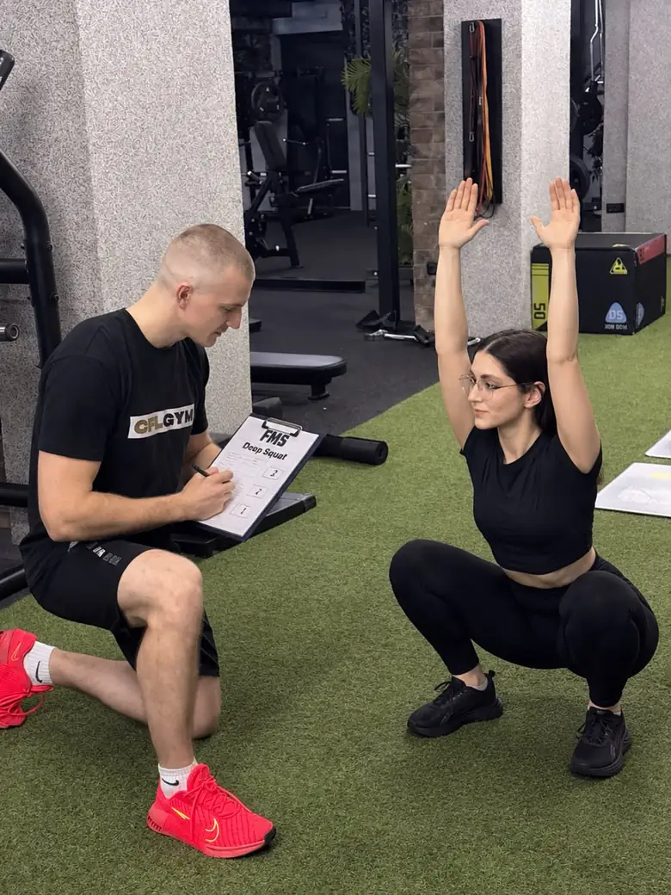

# Penda.fitness

Sajt personalnog trenera Stefana Milovanovića. Čist HTML, CSS i JavaScript, bez build koraka i bez spoljnih biblioteka, spreman za GitHub Pages.

## Šta je u fascikli

| Fajl | Namena |
| --- | --- |
| `index.html` | ceo sajt, sve sekcije od hero do footera |
| `politika-privatnosti.html` | politika privatnosti (link iz forme i footera) |
| `404.html` | stranica za pogrešan link |
| `assets/css/style.css` | stil, boje i razmaci su promenljive na vrhu fajla |
| `assets/js/main.js` | meni, koraci procesa, traka transformacija, zid poruka, razgovor u FAQ, mapa, forma |
| `assets/fonts/` | Manrope i Sofia Sans Extra Condensed, samo latinica sa srpskim slovima |
| `assets/img/` | fotografije (webp), mapa, slika za deljenje na mrežama |
| `robots.txt`, `sitemap.xml` | za pretraživače |
| `.nojekyll` | govori GitHub Pages da fajlove objavi bez obrade |

Sajt namerno nema ikonicu u tabu browsera (favicon) ni manifest za instalaciju na telefon.

## Šta ide na GitHub

Na GitHub ide samo ono što je u tabeli iznad. Spremna kopija je u fascikli `penda-fitness-github` (i kao `penda-fitness-github.zip`), pored radne fascikle `penda-fitness`.

Radna fascikla ima još `design/` (referenca dizajna) i `CLAUDE.md` (uputstvo za rad na projektu). Oni ne idu na GitHub: sajtu ne trebaju, a na GitHub Pages bi bili javno dostupni.

## Objavljivanje na GitHub Pages

1. Na GitHub-u napravi novi repozitorijum, na primer `penda-fitness`.
2. U koren repozitorijuma ubaci **sadržaj** fascikle `penda-fitness-github` (ne samu fasciklu). Najlakše preko sajta: **Add file › Upload files**, prevuci sve fajlove i fascikle, pa **Commit changes**. Fajl `.nojekyll` je prazan i počinje tačkom, proveri da je i on prebačen.
3. **Settings › Pages › Build and deployment**: Source **Deploy from a branch**, Branch **main**, folder **/ (root)**, pa **Save**.
4. Za minut ili dva sajt je na `https://darko-design.github.io/penda-fitness/`.

## Domen penda.fitness

Sajt je pripremljen za adresu `https://penda.fitness/` (canonical, slika za deljenje, sitemap).

1. **Settings › Pages › Custom domain**: upiši `penda.fitness` i sačuvaj.
2. Kod registra domena dodaj DNS zapise:
   - četiri **A** zapisa za `@`: `185.199.108.153`, `185.199.109.153`, `185.199.110.153`, `185.199.111.153`
   - **CNAME** za `www`: `darko-design.github.io`
3. Kada GitHub potvrdi domen, uključi **Enforce HTTPS**.

Ako sajt ide na drugi domen, zameni `https://penda.fitness/` u fajlovima `index.html`, `politika-privatnosti.html`, `robots.txt` i `sitemap.xml`.
Stranica `404.html` koristi putanje od korena domena, zato izgleda kako treba tek na pravom domenu.

## Forma za prijavu

Prijave stižu na **stefanpenda1998@gmail.com** preko besplatnog servisa FormSubmit, bez naloga i bez lozinki.

1. Kad sajt bude objavljen, pošalji jednu probnu prijavu.
2. Na stefanpenda1998@gmail.com stiže email od FormSubmit-a. Klikni **Activate Form**. Do aktivacije prijave se ne prosleđuju.
3. Preporuka: u tom emailu dobijaš i kod koji menja email adresu u adresi forme. Na vrhu `assets/js/main.js` zameni `FORM_ENDPOINT` sa `https://formsubmit.co/ajax/TVOJ_KOD`, a u `index.html` isto uradi u `action` forme `#forma`. Tako email adresa nije vidljiva u kodu.

Ako slanje ne uspe, posetilac vidi poruku sa brojem telefona.

## Privremena polja koja treba zameniti

**Transformacije.** Traka ima 12 parova PRE i POSLE. Drugih 6 parova je kopija prvih 6, zbog beskonačnog kruženja, i moraju ostati isti kao prvih 6. Za pravu fotografiju u `div.ph` dodaj sliku, oznaka ostaje iznad nje:

```html
<div class="ph"><span class="tag">Pre</span></div>
```

**Iskustva.** Zid ima 12 polja sa nacrtanim porukama (`button.shot`). Za pravi screenshot zameni sadržaj dugmeta slikom i podesi odnos stranica:

```html
<button class="shot" type="button" style="aspect-ratio:1080/1920" aria-label="Uvećaj poruku klijenta"></button>
```

**Proces, prvi korak.** Fotografija testiranja je privremeno polje na dva mesta u sekciji `#proces`: u kartici prvog koraka (`div.proces__img`, za telefon) i u velikom kadru (prvi `div.proces__shot`, za desktop). Kad stigne slika, sačuvaj je kao `assets/img/proces-testiranje.webp` i zameni oba polja:

```html
<div class="proces__img"></div>
```

```html

```

Slike sačuvaj kao webp, do 1200 px širine.

## Mapa

U sekciji prijave je mapa u bojama sajta sa tačnom adresom. Klik na adresu otvara Google mape i lokaciju CFL GYM, Mijačka 5. Crtež mape je ilustracija i ne prikazuje prave ulice. Prava Google mapa u istom tamnom stilu traži Google Maps API ključ, pa je možemo dodati kada ključ postoji.

## Pretraga

Već urađeno: naslov i opis stranice, canonical, slika za deljenje na mrežama, strukturirani podaci (LocalBusiness, Person, FAQPage), sitemap, robots, semantički naslovi i alt tekstovi.

Posle objavljivanja:
1. U **Google Search Console** dodaj domen i pošalji `sitemap.xml`.
2. Napravi ili dopuni **Google Business** profil sa istim imenom, adresom (CFL GYM, Mijačka 5, Beograd) i telefonom kao na sajtu.
